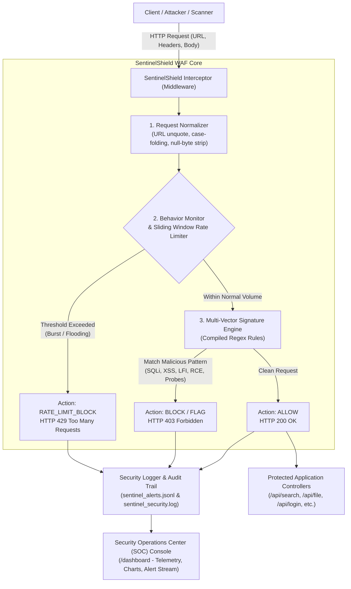

# SentinelShield System Architecture & Threat Lifecycle

## 1. High-Level Architectural Diagram

SentinelShield operates as an inline Web Application Firewall (WAF) and Intrusion Detection & Prevention System (IDS/IPS). It sits between incoming client traffic and backend application controllers.

---

## 2. Component Breakdown

### A. Request Normalization Pipeline
Attackers frequently use encoding obfuscation to bypass naive string matching (e.g. `%2e%2e%2f` instead of `../`, or `%27%20OR%201%3D1` instead of `' OR 1=1`).  
SentinelShield implements a multi-stage normalization pipeline before signature matching:
1. **Multi-Pass URL Decoding:** Resolves single and double percent-encoded byte sequences.
2. **Null-Byte Stripping:** Eliminates `%00` and `\x00` characters intended to terminate strings prematurely in underlying C-libraries.
3. **Case Normalization:** Standardizes casing to evaluate against case-insensitive rule triggers.
4. **Structure Flattening:** Extracts keys, values, headers, query parameters, and JSON/form bodies into inspected tokens.

### B. Behavior Monitoring & Sliding-Window Rate Limiter
* **Algorithm:** Sliding-window timestamp queue per client IP.
* **Tracking Window:** 10 seconds.
* **Threshold:** 12 requests per window.
* **Remediation:** If the threshold is breached, the IP is issued an automatic temporary ban (45 seconds), and all further requests are dropped with HTTP 429 (*Too Many Requests*).
* **Reset & Unban:** Administrators can manually unban an IP via the SOC dashboard or wait for timer expiration.

### C. Signature-Based Rule Engine (`rules.json`)
Predefined, categorized regular expressions target five core vulnerability types:
* **SQL Injection (SQLi):** Tautologies (`' OR '1'='1`), UNION statements, destructive administrative commands (`DROP`, `SLEEP`), and SQL comment terminators (`--`, `/* */`).
* **Cross-Site Scripting (XSS):** Script tags (`<script>`), inline HTML event handlers (`onerror=`, `onload=`), and URI pseudoprotocols (`javascript:`).
* **Local File Inclusion (LFI):** Directory traversal strings (`../`, `..\`), critical operating system files (`/etc/passwd`, `win.ini`, `/proc/self/environ`).
* **Remote Command Injection (RCE):** Shell metacharacters (`;`, `|`, `&&`) combined with execution commands (`cat`, `whoami`, `id`, `powershell`), and command substitution syntax (`$(...)`, `` `...` ``).
* **Reconnaissance & Scanner Probing:** Automated vulnerability scanning tools (`sqlmap`, `nikto`, `nuclei`) identified via User-Agent headers, and exposed administrative artifacts (`.git/config`, `.env`).

### D. Decision Broker & Interceptor
Depending on the active WAF mode:
* **BLOCKING Mode (IPS):** Immediately terminates the connection, emits a security block payload (JSON for APIs, HTML for browsers), sets response status to `403 Forbidden` (or `429 Too Many Requests`), and stamps forensic tracking headers (`X-Sentinel-Incident`, `X-Sentinel-Rule`).
* **MONITORING Mode (IDS):** Emits an alert log but allows the request to reach the application. Used for baseline threat observation without risking legitimate traffic disruption.

### E. Dual-Format Security Logger
* **Machine Log (`logs/sentinel_alerts.jsonl`):** JSON Lines format for SIEM ingestion, real-time SOC dashboard telemetry, and automated audit scripts.
* **Audit Trail (`logs/sentinel_security.log`):** Human-readable, timestamped format detailing `ACTION`, `SEVERITY`, `CLIENT_IP`, `METHOD`, `PATH`, `RULE`, `CATEGORY`, `TARGET`, and sanitized `PAYLOAD`.

### F. Security Operations Center (SOC) Console (`/dashboard`)
* Real-time KPI counters (Total Inspected, Clean, Blocked, Block Rate %).
* Threat category distribution bar visualization.
* Real-time stream of security incidents with instant rule inspection.
* IP reputation and sliding-window rate limit monitor with manual one-click unban.
* Built-in WAF Sandbox Inspector to test custom payloads directly in the browser.

